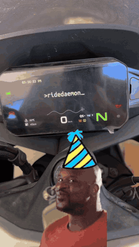

# Ridedaemon (Android)

A reference Android app showing how to integrate [Ridedaemon](https://github.com/charliecharlieO-o/ridedaemon-lib)
(the core Go library) into a real app: scan the HUD's WiFi QR code, connect
to it, discover the head unit, encode a live scene with `MediaCodec`, and
stream it to the bike's display.

**This is a demo/reference implementation, not a polished product.** It
exists to prove the integration works end-to-end and to give you a working
example to build from. Expect rough edges (a hardcoded delay here, an
unused stub screen there). See [Known rough edges](#known-rough-edges) below.

## Demo



## What it does

1. **Scan QR** (`feature/ap/QrScanScreen.kt`). Uses CameraX + ML Kit to
   read the HUD's setup QR code, which encodes its WiFi AP credentials as a
   URL (`ssid`, `pwd`, `auth`, etc).
2. **Connect to the HUD's AP** (`feature/ap/WifiApController.kt`). Suggests
   that network to Android via `WifiNetworkSuggestion`, then watches
   connectivity callbacks for the HUD's subnet (`192.168.0.x`) to confirm
   we're actually on its network.
3. **Discover + stream** (`core/hud/HudStreamController.kt`). Once
   connected, resolves the HUD over mDNS (`_EasyConn._tcp.`) using Android's
   `NsdManager`, opens a `MobileSession` from the Go library (via the
   `hudlib.aar` gomobile bindings), and starts a local encoder.
4. **Encode + render** (`core/hud/HudEncoder.kt`,
   `core/hud/Hud2DRenderer.kt`). A `MediaCodec` surface encoder produces
   H.264 (AVCC) samples from whatever's drawn on its input `Surface`; a
   small custom 2D scene renderer (`HudScene`/`HudElement`) draws onto that
   surface every frame (backgrounds, animated images, dynamic text, even a
   sine wave, useful building blocks for a real dashboard UI). Each encoded
   sample is handed to `MobileSession.pushFrame()`, which the Go library
   converts to Annex-B and streams to the HUD.
5. **HUD events**. `HudStreamController` listens for events coming back
   from the library (e.g. the HUD's safe-area/view config) and reacts to
   them, e.g. sizing the encoder to match what the HUD reports.

## Project layout

| Path | What's there |
|---|---|
| `core/hud/` | Everything HUD-specific: session/controller, `MediaCodec` encoder, and the 2D scene renderer used to draw content before it's encoded. |
| `core/qr/` | QR parsing/analysis (`QrAnalyzer`) for the HUD's WiFi setup code. |
| `feature/ap/` | WiFi AP connection flow: QR scan screen + `WifiApController`. |
| `feature/hud/` | The main `HudScreen`: start/stop streaming, scene switching, status display. |
| `feature/login/` | An unused stub, see below. |
| `navigation/` | Compose navigation graph (`Hud` / `QrScan` / `Login` routes). |

## Setup

1. Build the Go library's Android bindings (see the
   [ridedaemon-lib](../ridedaemon-lib) README) and drop the resulting AAR at:
   ```
   app/libs/hudlib.aar
   ```
   The app depends on it directly via `implementation(files("libs/hudlib.aar"))`
   in `app/build.gradle.kts`.
2. Open in Android Studio or build from the CLI:
   ```bash
   ./gradlew assembleDebug
   ```
3. Install on a phone (not an emulator; you'll need real WiFi/camera/NSD).
   `minSdk` is 29.

## Known rough edges

Being upfront about what's demo-quality here, so it's clear what to firm up
before leaning on this as a template:

- **`feature/login/LoginScreen.kt` is an empty stub.** It's wired into the
  nav graph but never actually navigated to or implemented. Leftover
  scaffolding from an earlier idea, safe to remove or build out.
- **`HudStreamController.onHudConnected` has a hardcoded 8-second delay**
  before starting the stream, to give the HUD's app time to settle after
  the WiFi handoff. This works but isn't principled. Note: a retry/backoff on
  the actual mDNS resolution would be more robust than a flat sleep.
- **The manifest declares a few permissions twice** (`ACCESS_WIFI_STATE`,
  `ACCESS_FINE_LOCATION`, `CHANGE_WIFI_MULTICAST_STATE`,
  `NEARBY_WIFI_DEVICES` each appear in two separate blocks). Harmless, but
  worth consolidating.
- **Sample `HudElement` scenes are left commented out** in `HudScreen.kt` as
  quick reference/copy-paste material.
- **Package name is `com.nos.ridedaemon`**, update `applicationId`/`namespace` if you
  want it consistent.
- No tests.

None of this blocks it working as a demo. Just don't treat the patterns
above as the recommended way to do things in a production app.

## Status

Not affiliated with or endorsed by CFMoto. Built to work with hardware I
own, as a demonstration of the Ridedaemon library.

## License

GPL-3.0. See [LICENSE](LICENSE.md) (same terms as the core library).

In short:

**You can:**
- Use, study, and modify this code, including commercially.
- Redistribute it, modified or not.
- Ship it as part of a larger project.

**You can't:**
- Redistribute it (or anything that includes it) as closed source. Any
  distributed derivative work must also be GPL-3.0 and include source.
- Hold Ridedaemon or its contributors liable. It's provided with no
  warranty.
- Sublicense it under different, more restrictive terms.

This is a plain-language summary, not a substitute for the license text.
The [LICENSE](LICENSE.md) file is what actually governs.
